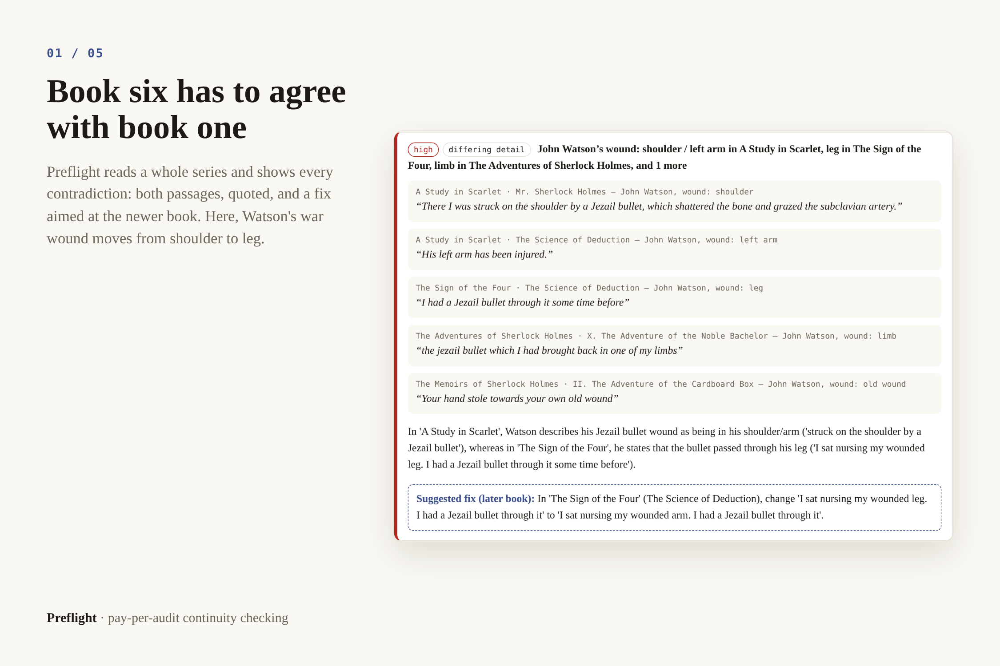
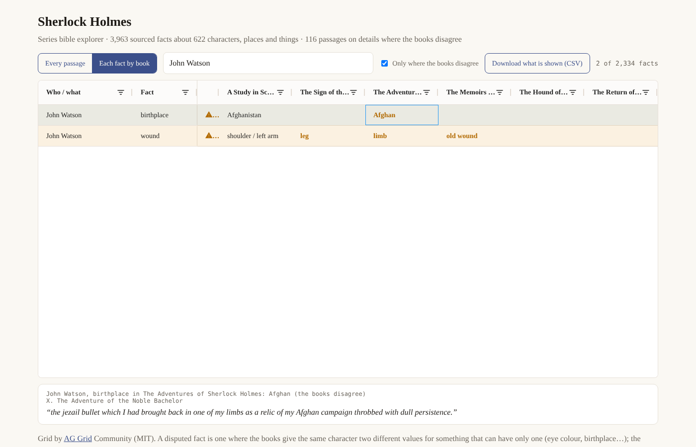

# Preflight · continuity audits for book series, paid per audit with PayPal

[](https://github.com/nolankido/canonKeeper/actions/workflows/ci.yml)  [](LICENSE) [](https://preflight-kq1o.onrender.com)

**Book six has to agree with book one. Preflight reads the whole series and shows you, with the
passages, every place it doesn't.**

[](https://preflight-kq1o.onrender.com/sample)

Series authors publish books years apart, and readers track every detail: an eye colour that
drifts, a character who dies and keeps talking, a birthplace that moves between book two and book
five. Today the only tool for this is a spreadsheet and a good memory. Preflight is built on
**canonkeeper**, the open-source engine in this repository, by a working indie publisher with 80+
titles across four series imprints.

| | |
|---|---|
| **What it does** | Every contradiction across a series, with both passages and a fix to the later book |
| **Who it's for** | Authors of long-running series, their editors, small presses |
| **What it costs** | $5 + $4 per 100k tokens, arithmetic shown first: a 100,000-word novel ≈ $10.50 |
| **How you pay** | PayPal (sandbox here); nothing reaches a model before the capture; refunds through PayPal |
| **Agents welcome** | A hosted MCP server: assistants buy from a PayPal-funded budget, and only the person approves |
| **What you get** | The report, the series bible as an [AG Grid explorer](#the-bible-explorer-ag-grid) and a spreadsheet, the findings as JSON |

The details: the bible ties every fact about every character and place to the exact sentence it
came from; a draft of the next book can be checked against everything already published ($2 +
the same rate on the draft). A failed audit is refunded in full; mark a contradiction wrong and
$0.50 comes back, up to half the price. An assistant never holds a PayPal credential, only a
budget's spending key capped by the balance and the person's limits (a most-per-purchase and an
end date, which the person can tighten but nobody can loosen); it asks the person to approve
every payment and to confirm every refund.

### For judges: two minutes

| | Where | What to look at |
|---|---|---|
| 1 | [preflight-kq1o.onrender.com](https://preflight-kq1o.onrender.com) | *Try it with the demo series*: the price with its arithmetic, PayPal's own buttons (sandbox: test money only), the audit, the report. Nothing reaches a model before PayPal confirms the capture. |
| 2 | [/sample](https://preflight-kq1o.onrender.com/sample) and [its bible](https://preflight-kq1o.onrender.com/sample/bible?view=bybook&focus=John%20Watson%7Cwound&book=The%20Sign%20of%20the%20Four) | The real audit of six Sherlock Holmes books. Each finding's *in the bible explorer* link opens AG Grid on that fact, one column per book, with the later book's passage below. |
| 3 | [/assistant](https://preflight-kq1o.onrender.com/assistant): MCP at `https://preflight-kq1o.onrender.com/mcp` | Add it as a custom connector in an MCP assistant and say "Open a $20 Preflight budget", approve on PayPal, then "Audit the Saltmarsh demo series and pay from the budget". |
| 4 | [`preflight/payments.py`](src/canonkeeper/preflight/payments.py) | The money paths: one function pays a job, budgets never overdraw, refunds are recorded before PayPal is asked. |
| 5 | [The benchmark](#does-it-actually-work-the-seeded-defect-benchmark) | Precision and recall measured on planted errors, misses included. |


*A real agent session, sped up: Claude (Claude Code, headless) buying from Preflight over MCP
with a $20 PayPal-sandbox budget it can never overspend; the person approves the payment and
confirms the one refund. Real sandbox transactions on a local copy of Preflight; the demo series'
findings are real Gemini answers, recorded and replayed. [Transcript and PayPal ids](docs/agent-session/).*

Built during the PayPal AI Hackathon 2026 (the repository starts on Oct 26, 2026).

**See a finished audit first:** [the six Sherlock Holmes volumes](#what-it-found-in-sherlock-holmes),
3,963 sourced facts and the canon's two famous slips found with no hints (Watson's war wound in the
shoulder and then the leg; a landlady who is Mrs. Hudson and then Mrs. Turner). The full page is
`/sample` on any running Preflight, or open
[`sherlock-holmes-report.html`](src/canonkeeper/preflight/samples/sherlock-holmes-report.html) in a
browser.

**Where your text goes.**
- *The hosted demo* runs on Gemini's free tier, whose [terms](https://ai.google.dev/gemini-api/terms)
  let Google use submitted text to improve its products and have it read by human reviewers. So it
  takes public-domain books and the built-in demo series only, and every page says so.
- *Your own manuscripts:* run Preflight yourself with a local model (`--provider openweights`,
  [measured](docs/ENGINE.md#local-mode-measured)), and the text never leaves your machine.
- *A commercial Preflight* would run the same code on a billed API tier, where Google's terms say
  prompts are not used to improve its products; every quote already carries the list price of the
  models it would use.

**Try it** (Python 3.11+, no keys, no card): `pip install -e .` then `canonkeeper serve`, open
http://127.0.0.1:8787 and press *Try it with the demo series*. With no keys the whole flow runs
(upload, quote, pay, report) and each page says payments are simulated and answers come from a
rule-based stand-in. Add `GEMINI_API_KEY` for real audits and `PAYPAL_CLIENT_ID` /
`PAYPAL_CLIENT_SECRET` for the PayPal sandbox ([details](#preflight-in-detail-paypal)).

Entered in the [PayPal AI Hackathon 2026](https://paypalaihackathon.devpost.com/).


---

## The engine: how canonkeeper works

```
 series.json ──▶ fetch/chapterize ──▶ extract claims ──▶ bible.jsonl
                                    (cheap long-ctx model)    │
                                                              ▼
                     report.html ◀── adjudicate ◀── candidate conflicts
                                  (stronger model)   (local heuristics, $0)
```

A cheap long-context model reads every chapter into atomic facts, each with a **verbatim quote**
(a fact whose quote cannot be found in the text is dropped: nothing enters the bible without a
passage behind it). Local heuristics over-generate candidate conflicts at no cost. A stronger
model judges them in batches with the series text in context, and may clear a conflict only by
quoting the passage that explains it (a reveal, a disguise, time passing); everything else is a
contradiction with a fix aimed at the later book, or left to the author. Gemini's free tier by
default (`gemini-3.5-flash-lite` reads, `gemini-3.6-flash` judges), any OpenAI-compatible host,
or a local model for private books.

The stages, the quickstart with real models, local mode (measured), the models, the free tier's
daily limits and what a run costs are in [docs/ENGINE.md](docs/ENGINE.md); the reasoning behind
them in [docs/ARCHITECTURE.md](docs/ARCHITECTURE.md).

## What it found in Sherlock Holmes

Six Conan Doyle volumes from Project Gutenberg (457,890 words, 630k tokens), on the Gemini
free tier, with no hints. Latest run (2026-10-27):

| | |
|---|---|
| facts extracted | 3,963 about 622 characters, places and things (99.5% of returned claims grounded to a verbatim passage) |
| candidate conflicts screened | 27, all judged with the relevant chapters in context (two screens raised the same Dr. Becher question; the report shows it once, so 26 findings) |
| **contradiction, correct** | **Watson's war wound** — "struck on the shoulder by a Jezail bullet" (*A Study in Scarlet*) vs "sat nursing my wounded leg" (*The Sign of the Four*). Fix, to the later book: "wounded leg" → "wounded arm". |
| **contradiction, correct** | **The landlady** — Mrs. Hudson at Baker Street (*The Sign of the Four*), "When Mrs. Turner has brought in the tray" (*A Scandal in Bohemia*): "No explanation or change of staff is given in the text." Fix: "Mrs. Turner" → "Mrs. Hudson". |
| contradiction, wrong | Holmes's "keen dark eyes" in *The Sign of the Four* — he is disguised as an old sailor in that scene (an earlier run ruled this deliberate); Mrs. Barclay vs "Nancy Devoy", which is her maiden name |
| cleared, each on a quoted passage | 18 — e.g. Holmes "dying" at the Reichenbach Falls and then acting in *The Hound* ("I have arrived at a point in my narrative where I am compelled … to trust once more to my recollections, aided by the diary which I kept at the time": *The Hound* is set earlier); Jefferson Hope's hair ("his black hair turned grizzled"); two different Lucys; wounds from different cases |
| needs your judgement | 4 — the model would not clear them and would not call them errors (Dr. Becher, "is he a German?" / "an Englishman") |
| list-price cost | about $1.40 to read (444 extraction calls, estimated from the request log) and $0.15 to judge; $0 on the free tier |

The two best-known continuity errors in the canon, found unassisted, each with its passages on
the page:


Every fact behind it is browsable in the bible page, with its source passage one click away:


The two wrong calls are exactly what the next prompt revision targets (look for a disguise in
the scene; maiden and married names), and like any prompt change it will be measured with the
benchmark below before it ships. Mary Watson calling her husband "James" (*The Man with the
Twisted Lip*) is still not caught by default: a name given only in speech is not recorded as a
`first_name`. A fix that points the extractor at names spoken in dialogue is built and off by
default (`CANONKEEPER_EXTRACT_SPEECH_NAMES=true`) until the benchmark measures it.

## The bible explorer (AG Grid)

A series bible is a table nobody can read as a page: the six Holmes volumes give 3,963 sourced
facts about 622 characters, places and things. The explorer puts them in
[AG Grid Community](https://www.ag-grid.com/) (MIT, version 36.2.0, served by Preflight with a
pinned CDN fallback), in two views:

- **Every passage:** one row per fact with its book, chapter and the sentence that states it.
  Sort and filter any column, search everything at once, tick *Only where the books disagree*,
  click a row to read the passage, and download exactly what is shown as CSV.
- **Each fact by book:** one row per character fact, one column per book in reading order. Where
  a book changes the value an earlier book gave, the cell is marked; click it for that book's
  passages. Watson's wound reads *shoulder / left arm* in *A Study in Scarlet*, *leg* in *The
  Sign of the Four*, *limb* in the *Adventures*, *old wound* in the *Memoirs*: the canon's most
  famous slip, as a row.



**What each book changes, charted.** Above the grid, an AG Charts bar for each book counts the
facts it changes from what an earlier book said; click a bar and the grid shows just those facts,
each book's value side by side (the filter is in the address too: `?changed=<book>`).

**In the report, too.** Every report opens with *Every finding at a glance*: an AG Grid of every
finding (the model's call, severity, the check that raised it, the author's own call), sortable,
filterable and searchable; clicking a row opens that finding's card with its passages. On the author's own copy the grid is
also where they work: an item left to them is ruled on in the *Author* cell (saved at once, shown on
the card), and *mark wrong…* on a contradiction opens the job page row where its refund is
confirmed. On the
Holmes sample that is 26 findings, four of them contradictions.

Every finished audit gets its own explorer (`/jobs/<id>/bible-grid.html`, also downloadable as
one self-contained file), and the Holmes one is at `/sample/bible`. The view lives in the
address (`?view=bybook&disputed=1&q=…&focus=<who>|<fact>&book=<book>`), so every finding in a
report links to its own row: [Watson's wound](https://preflight-kq1o.onrender.com/sample/bible?view=bybook&focus=John%20Watson%7Cwound&book=The%20Sign%20of%20the%20Four). On a phone it keeps who, fact and value,
and opens the passage below the grid on a tap.

## Does it actually work? The seeded-defect benchmark

Eyeballing output is not evidence. `canonkeeper eval` takes a clean series and its bible,
**plants N contradictions in the prose of later books** (a new eye colour, a different
birthplace, a character quietly buried and then walking around), re-runs the *entire* pipeline
on the mutated text, and scores what came back against ground truth. Contradictions that were
already in the source — Conan Doyle has several — are measured in a baseline run and excluded
from the false-positive count.

```bash
canonkeeper eval evals/corpora/sherlock-holmes/series.json --n 20 --seed 0
```

| corpus | run | injected | reported | TP | FP | FN | precision | recall | F1 |
|---|---|---:|---:|---:|---:|---:|---:|---:|---:|
| Sherlock Holmes (6 volumes) | 1 · general pass only, low effort | 20 | 1 | 1 | 0 | 19 | 1.00 | 0.05 | 0.10 |
| Sherlock Holmes (6 volumes) | 2 · + descriptive sweep, medium effort, evidence-checked verdicts — as written by the run | 20 | 11 | 7 | 4 | 13 | 0.64 | 0.35 | 0.45 |
| Sherlock Holmes (6 volumes) | 2 · same run, rescored (`canonkeeper rescore`) | 20 | 11 | 8 | 2 | 12 | **0.80** | **0.40** | **0.53** |

The first number was bad, and it is the reason the harness exists: every one of the 19 misses
was lost at **extraction**, not at judgement. A second, narrow extraction pass over descriptive
facts and a higher reasoning budget took recall from 0.05 to 0.35–0.40, with precision 0.64–0.80.

Run 2 plants a different 20 defects than run 1 (the rebuilt bible changed which facts were
eligible), so the rows are not a paired comparison. The rescored row applies two scoring rules
added after reading run 2's misses — a planted "Susan Cushing" extracted as "Miss Cushing" is
the same person, and a contradiction that quotes a planted sentence for another reason is listed
apart rather than as a false positive — and both rows are kept so the effect of the rule change
is visible. All files are in [`evals/results/holmes-seed0-2026-10-27`](evals/results/holmes-seed0-2026-10-27);
`canonkeeper rescore` reproduces the score with no model calls.

**Where recall is still lost** (the run's own per-stage breakdown): of 12 misses, 8 were never
extracted from the planted sentence (mostly a one-line eye-colour or first-name remark in a
chapter about someone else), and 4 were judged not to be contradictions — two of those were
plants that were not clear contradictions ("dark" vs "brown" eyes; Watson "born in Afghanistan",
which was the bible misreading where he served). The benchmark now refuses such plants, and
extraction is where the next round of work goes. Judging in run 2 was half `gemini-3.6-flash`,
half `gemini-3.5-flash-lite` after the free-tier fallback.

## Preflight in detail (PayPal)

```
upload series (.docx, .txt, .md) ──▶ quote ($5 + $4 per 100k tokens, arithmetic shown) ──▶ PayPal checkout
      ──▶ capture of exactly the quoted amount ──▶ the audit runs ──▶ report + bible
writing the next book? ──▶ a draft check ($2 + the same rate on the draft) ──▶ same checkout
```

- **One rule for every way a payment arrives.** PayPal's JS SDK buttons, the redirect to
  PayPal's page (what an assistant's link uses), the "check payment" button and PayPal's verified
  webhooks all end in one function, `settle()` in
  [`preflight/payments.py`](src/canonkeeper/preflight/payments.py): a job is paid only on a
  completed capture of the quoted amount, and nothing reaches a model before that.
- **Money goes back the same way.** A failed audit is refunded in full; a finding marked wrong
  returns $0.50 (up to half the price); closing an assistant budget refunds the unused rest. Each
  refund is recorded with its `PayPal-Request-Id` before PayPal is asked, so a retry never pays
  twice.
- **Agents are customers, never approvers.** The hosted MCP server's 19 annotated tools quote,
  order, pay from a PayPal-funded budget (with the person's limits) and read findings; the
  approval link always goes to the person.
- **Built to last the judging period on free tiers:** kept awake on Render, a quota check that
  refuses an order before PayPal when the day's model quota can't finish it, real Gemini answers
  for the demo series shipped in the package, and a daily smoke test. Jobs and budgets are JSON
  files on the instance's disk, which a free Render instance loses when it is redeployed, so
  deploys are frozen from submission (Nov 12) to the end of judging; a paid deploy would keep
  them on a persistent disk or in a database (sandbox money only here).

<p align="center">


</p>

**Tested on PayPal's real sandbox, end to end** (Oct 28, 2026): a demo audit paid with PayPal's
card button (order `0VT10566WP533404Y`, capture `93D58029P7835205H`) and a finding marked wrong
($0.50 partial refund `3AA80535F2725261T`); and a $10 assistant budget funded through PayPal,
$5.05 spent on an audit over MCP, $0.50 credited back, and closed with the unused $5.45 refunded
(refund `5B922440HT719290M`).

Everything else (the commands, Render, the webhook, the stdio MCP server, the full status list)
is in [docs/PREFLIGHT.md](docs/PREFLIGHT.md).

## Status

Done: the engine, the paid service on the live PayPal sandbox, the hosted MCP server with
assistant budgets, the AG Grid bible explorer and report triage, the seeded-defect benchmark, CI
on Linux and Windows. Still to come before Nov 12: the final video and the last benchmark runs.
The item-by-item list is in [docs/PREFLIGHT.md](docs/PREFLIGHT.md#status-item-by-item).

## License

MIT. Public-domain corpora are fetched from [Project Gutenberg](https://www.gutenberg.org/) at
run time and are not redistributed here.
