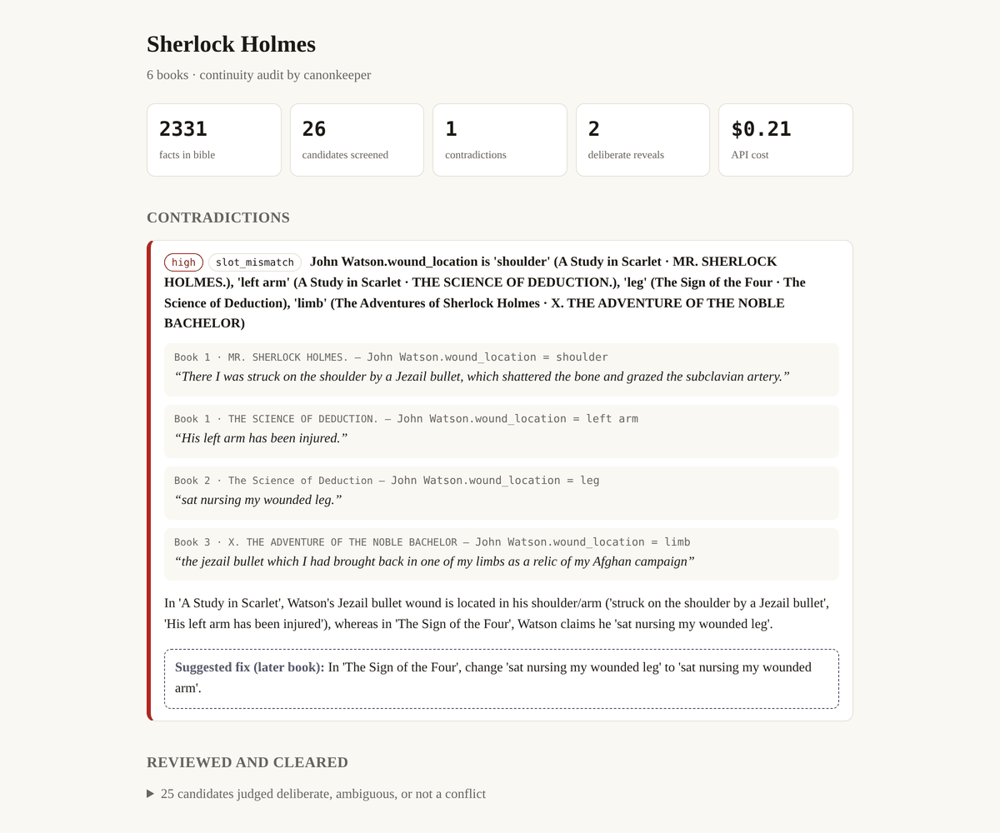
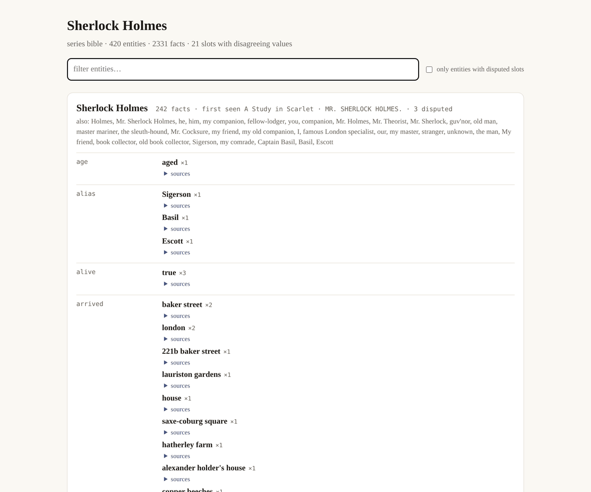
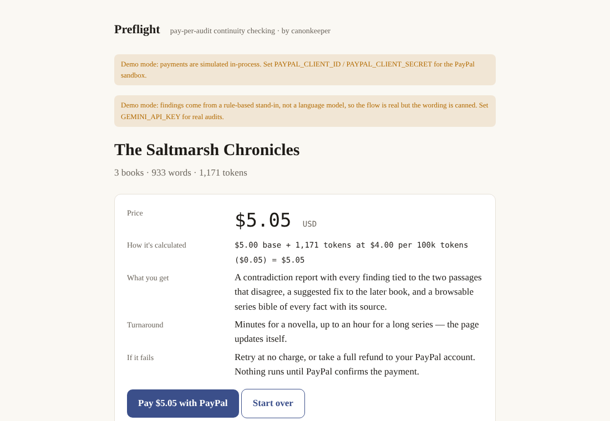
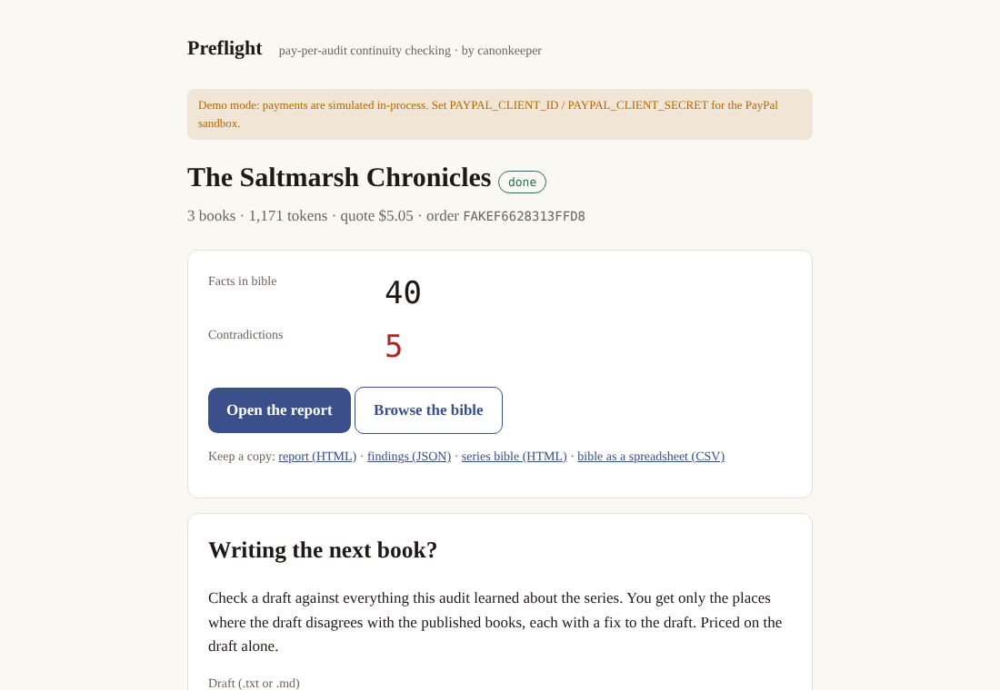

# Preflight · continuity audits for book series, paid per audit with PayPal

**Book six has to agree with book one. Preflight reads the whole series and shows you, with the
passages, every place it doesn't.**

Series authors publish books years apart, and readers track every detail: an eye colour that
drifts, a character who dies and keeps talking, a birthplace that moves between book two and book
five. Today the only tool for this is a spreadsheet and a good memory. Preflight is built on
**canonkeeper**, the open-source engine in this repository, by a working indie publisher with 80+
titles across four series imprints.

| | |
|---|---|
| **What it does** | Reads every chapter, builds a *series bible* (every fact about every character and place, each carrying the exact sentence it came from), and reports what cannot all be true: each contradiction with both passages and a fix aimed at the *later* book (the earlier ones are published). Writing the next book? Check the draft against everything already published. |
| **Who it's for** | Authors of long-running series, their editors, small presses |
| **What it costs** | $5 + $4 per 100,000 tokens (about 73,000 words of fiction), shown with its arithmetic before you pay: a 100,000-word novel is about $10.50, the six Sherlock Holmes volumes $30.20. A draft check is $2 + the same rate on the draft alone. |
| **How you pay** | PayPal Checkout (Orders v2; this hackathon build runs on PayPal's sandbox, so it is test money). Nothing reaches a model until PayPal confirms the capture of exactly the quoted amount; an audit that cannot finish is refunded in full through PayPal. **The finding guarantee:** mark a contradiction wrong and it is noted on the report beside the model's call, and $0.50 goes back through PayPal for each one, up to half the price. |
| **Agents welcome** | The same service is an MCP server at `<url>/mcp` (streamable HTTP; or `canonkeeper mcp` on stdio): an author's AI assistant connects as a customer, holding no keys. It asks for an upload link, the person uploads the books and sees the price, the assistant orders, and the PayPal approval link always goes to the person. Or the person funds an **assistant budget** once through PayPal ($5-$200): the assistant pays for audits and draft checks from it without asking each time, never past the balance; every spend is on the budget's page, a failed audit is credited back, and closing it refunds the unused rest to PayPal. |
| **What you get** | The report (HTML, prints to PDF); the series bible as an explorer (an [AG Grid](https://www.ag-grid.com/) of every fact: sort, filter, search, disputed facts flagged, the passage one click away, CSV of whatever is shown), as cards, and as a spreadsheet; and the findings as JSON |

**See a finished audit first:** [the six Sherlock Holmes volumes](#what-it-found-in-sherlock-holmes),
3,963 sourced facts and the canon's two famous slips found with no hints (Watson's war wound in the
shoulder and then the leg; a landlady who is Mrs. Hudson and then Mrs. Turner). The full page is
`/sample` on any running Preflight, or open
[`sherlock-holmes-report.html`](src/canonkeeper/preflight/samples/sherlock-holmes-report.html) in a
browser.

**Where your text goes.**
- *The hosted demo* runs on Gemini's free tier, whose [terms](https://ai.google.dev/gemini-api/terms)
  let Google use submitted text to improve its products and have it read by human reviewers. So it
  takes public-domain books and the built-in demo series only, and every page says so.
- *Your own manuscripts:* run Preflight yourself with a local model (`--provider openweights`,
  [measured below](#local-mode-measured)), and the text never leaves your machine.
- *A commercial Preflight* would run the same code on a billed API tier, where Google's terms say
  prompts are not used to improve its products; every quote already carries the list price of the
  models it would use.

**Try it** (Python 3.11+, no keys, no card): `pip install -e .` then `canonkeeper serve`, open
http://127.0.0.1:8787 and press *Try it with the demo series*. With no keys the whole flow runs
(upload, quote, pay, report) and each page says payments are simulated and answers come from a
rule-based stand-in. Add `GEMINI_API_KEY` for real audits and `PAYPAL_CLIENT_ID` /
`PAYPAL_CLIENT_SECRET` for the PayPal sandbox ([details](#preflight-in-detail-paypal)).

Entered in the [PayPal AI Hackathon 2026](https://paypalaihackathon.devpost.com/).

[](https://github.com/nolankido/canonKeeper/actions/workflows/ci.yml)


---

## The engine: how canonkeeper works

```
 series.json ──▶ fetch/chapterize ──▶ extract claims ──▶ bible.jsonl
                                    (cheap long-ctx model)    │
                                                              ▼
                     report.html ◀── adjudicate ◀── candidate conflicts
                                  (stronger model)   (local heuristics, $0)
```

0. **Chapterize.** Headings are taken from the book's own Contents list when it has one, so a
   `CHAPTER I.` with its title on the next line, a `I. A SCANDAL IN BOHEMIA`, or an unnumbered
   `THE ADVENTURE OF THE EMPTY HOUSE` all resolve to the right chapter, and the Contents block,
   `PART` dividers and shouted body lines (`RACHE.`) do not split anything. Tuned against the
   actual Project Gutenberg layouts of all six Holmes volumes. Authors' own files work too:
   Markdown `#` headings, `Chapter 1`, a bare `1` or `II.`; Word's UTF-16 text and
   Windows-1252 files are read as they are, and a chapter pasted without blank lines between
   paragraphs is still cut into readable chunks.
1. **Extract.** Each chapter goes to the extraction model (`gemini-3.5-flash-lite` by default) with a strict schema: atomic claims
   (`Watson · wound_location = shoulder`), a fixed predicate vocabulary, and a **verbatim quote**
   for every claim. Claims whose quote cannot be found in the source chunk are dropped — that is
   the hallucination guard. Nothing enters the bible without a passage behind it.
2. **Screen.** Cheap local heuristics over-generate candidate conflicts: same entity + same
   single-valued predicate + different value; a character who dies and then acts; conflicting
   years; name drift. No model calls.
3. **Adjudicate.** Candidates go to the adjudication model **in batches**, with the series text sent
   once per batch as a stable prefix (so a cache-aware host serves it cheaply) and the batch of
   candidates last: each with its quotes and everything else the bible knows about that entity.
   With a 1M-token model a typical series fits whole; when it doesn't,
   the chapters the batch's quotes came from go in first. The verdict per candidate is one of
   `contradiction` / `deliberate` (a reveal, a lie, a disguise, change over time) / `ambiguous` /
   `not_conflict` (the bible was wrong), with severity, an explanation, and a minimal fix to the
   *later* book. Earlier books are published; you never edit those.
4. **Report.** Two HTML pages: the audit (every finding opens to the lines that caused it) and
   the bible itself (one card per entity, every fact sourced, disputed slots flagged), plus the
   bible as a spreadsheet (`bible.csv`, one row per fact with its passage) and the findings as
   JSON. Both pages print or save to PDF cleanly.

The split is deliberate: the extractor reads cheaply and widely; the adjudicator thinks
expensively and only where it matters. Batching means the cost of reading the series is paid once per eight
candidates, not once per candidate.

## Try it in 30 seconds, no key

```bash
pip install -e ".[dev]"
canonkeeper demo --open-report
```

That writes an invented three-book series with five planted continuity errors, runs the whole
pipeline against a deterministic rule-based stand-in, and opens the report. All five are found.
It then checks an unpublished fourth-book draft against the bible: two slips come back as
contradictions with fixes, and one change the draft *explains* (a character's eye colour was a
trick of tinted glasses) comes back as `deliberate`. That distinction is the whole point.
It is the same code path the real models use; only the provider differs.

## Quickstart with real models (Gemini free tier, no card)

```bash
cp .env.example .env            # paste GEMINI_API_KEY from https://aistudio.google.com/apikey
canonkeeper doctor              # key present? endpoint answers? pacing set?

canonkeeper fetch    evals/corpora/sherlock-holmes/series.json   # pulls the books from Project Gutenberg
canonkeeper estimate evals/corpora/sherlock-holmes/series.json   # tokens + dollars before you spend any
canonkeeper build    evals/corpora/sherlock-holmes/series.json   # extract the bible
canonkeeper bible    evals/corpora/sherlock-holmes/series.json   # browse it
canonkeeper audit    evals/corpora/sherlock-holmes/series.json   # find + adjudicate contradictions
```

Check your next manuscript against the bible without touching it. The repo ships an original
"book seven" Holmes draft with three slips and one explained change planted in it:

```bash
canonkeeper check evals/corpora/sherlock-holmes/series.json evals/demo/holmes-book-07-draft.md
```

On the free tier (2026-10-27) it caught **Holmes's height** ("barely five feet and a half"
against "rather over six feet") and missed the other two slips: Mary Morstan's brown eyes were
never extracted from a relative clause ("the brown eyes that had first drawn me to her"), and a
living Jefferson Hope ("He is still in Pentonville") was extracted as an *attribute*, which the
dead-character screen ignored — fixed since. The white hair raised no false alarm: the extractor
recorded the hair under the wig. Only conflicts that involve the draft are judged.

`--provider mock` works on any command and is what the test suite and `demo` use.
`--provider openweights` points the same pipeline at Ollama, LM Studio, or any OpenAI-compatible
host — the right choice for manuscripts that must not leave your machine.

### Local mode, measured

```bash
ollama pull qwen3:4b                    # 2.5 GB
OLLAMA_CONTEXT_LENGTH=16384 ollama serve  # the default 4k window silently truncates prompts
canonkeeper build  series.json --provider openweights
canonkeeper audit  series.json --provider openweights
```

On a laptop CPU (no GPU, Ollama 0.21) with `qwen3:4b`, on the three-book Saltmarsh demo with five
planted errors:

| stage | result |
|---|---|
| speed | ~90 s per extraction call, ~2.5 min per judgement; thinking is switched off by default (with it on, a one-line JSON reply took over 55 s) |
| extraction | 84 facts, **every one grounded** to a verbatim quote; 3 of the 5 planted errors reached the screen (the "Toby"/"Tom" name change and the moved wound were not extracted) |
| judgement | the 4B model ruled all three real conflicts "deliberate" or "not a conflict" on invented reasons ("likely character development"). Because clearing a conflict must now quote the passage that explains it, all three were moved to **Needs your judgement** instead of being dismissed |

So a small local model gives you a private, sourced bible and a list of candidate
contradictions to read yourself; it does not give you trustworthy verdicts. A larger local
model, or Gemini for public-domain text, does the judging.

> The Gemini free tier may use prompts to improve Google's products. canonkeeper says so every
> time it sends text through it. Public-domain corpora: fine. Unpublished manuscripts: use a
> paid tier or a local model.

## What it found in Sherlock Holmes

Six Conan Doyle volumes from Project Gutenberg (457,890 words, 630k tokens), on the Gemini
free tier, with no hints. Latest run (2026-10-27):

| | |
|---|---|
| facts extracted | 3,963 across 624 entities (99.5% of returned claims grounded to a verbatim passage) |
| candidate conflicts screened | 27, all judged with the relevant chapters in context |
| **contradiction, correct** | **Watson's war wound** — "struck on the shoulder by a Jezail bullet" (*A Study in Scarlet*) vs "sat nursing my wounded leg. I had a Jezail bullet through it" (*The Sign of the Four*). Fix, to the later book: "wounded leg" → "wounded arm". |
| **contradiction, correct** | **The landlady** — Mrs. Hudson at Baker Street (*The Sign of the Four*), "When Mrs. Turner has brought in the tray" (*A Scandal in Bohemia*): "No explanation or change of staff is given in the text." Fix: "Mrs. Turner" → "Mrs. Hudson". |
| contradiction, wrong | Holmes's "keen dark eyes" in *The Sign of the Four* — he is disguised as an old sailor in that scene (an earlier run ruled this deliberate); Mrs. Barclay vs "Nancy Devoy", which is her maiden name |
| cleared, each on a quoted passage | 18 — e.g. Holmes "dying" at the Reichenbach Falls and then acting in *The Hound* ("I have arrived at a point in my narrative where I am compelled … to trust once more to my recollections, aided by the diary which I kept at the time": *The Hound* is set earlier); Jefferson Hope's hair ("his black hair turned grizzled"); two different Lucys; wounds from different cases |
| needs your judgement | 5 — the model would not clear them and would not call them errors (Dr. Becher, "is he a German?" / "an Englishman") |
| list-price cost | about $1.40 to read (444 extraction calls, estimated from the request log) and $0.15 to judge; $0 on the free tier |

The two best-known continuity errors in the canon, found unassisted, each with its passages on
the page:



Every fact behind it is browsable in the bible page, with its source passage one click away:



The two wrong calls are exactly what the next prompt revision targets (look for a disguise in
the scene; maiden and married names), and like any prompt change it will be measured with the
benchmark below before it ships. Mary Watson calling her husband "James" (*The Man with the
Twisted Lip*) is still not caught: the extractor does not record a vocative inside dialogue as
a `first_name` claim.

## Does it actually work? The seeded-defect benchmark

Eyeballing output is not evidence. `canonkeeper eval` takes a clean series and its bible,
**plants N contradictions in the prose of later books** (a new eye colour, a different
birthplace, a character quietly buried and then walking around), re-runs the *entire* pipeline
on the mutated text, and scores what came back against ground truth. Contradictions that were
already in the source — Conan Doyle has several — are measured in a baseline run and excluded
from the false-positive count.

```bash
canonkeeper eval evals/corpora/sherlock-holmes/series.json --n 20 --seed 0
```

| corpus | run | injected | reported | TP | FP | FN | precision | recall | F1 |
|---|---|---:|---:|---:|---:|---:|---:|---:|---:|
| Sherlock Holmes (6 volumes) | 1 · general pass only, low effort | 20 | 1 | 1 | 0 | 19 | 1.00 | 0.05 | 0.10 |
| Sherlock Holmes (6 volumes) | 2 · + descriptive sweep, medium effort, evidence-checked verdicts — as written by the run | 20 | 11 | 7 | 4 | 13 | 0.64 | 0.35 | 0.45 |
| Sherlock Holmes (6 volumes) | 2 · same run, rescored (`canonkeeper rescore`) | 20 | 11 | 8 | 2 | 12 | **0.80** | **0.40** | **0.53** |

The first number was bad, and it is the reason the harness exists: every one of the 19 misses
was lost at **extraction**, not at judgement. A second, narrow extraction pass over descriptive
facts and a higher reasoning budget took recall from 0.05 to 0.35–0.40, with precision 0.64–0.80.

Run 2 plants a different 20 defects than run 1 (the rebuilt bible changed which facts were
eligible), so the rows are not a paired comparison. The rescored row applies two scoring rules
added after reading run 2's misses — a planted "Susan Cushing" extracted as "Miss Cushing" is
the same person, and a contradiction that quotes a planted sentence for another reason is listed
apart rather than as a false positive — and both rows are kept so the effect of the rule change
is visible. All files are in [`evals/results/holmes-seed0-2026-10-27`](evals/results/holmes-seed0-2026-10-27);
`canonkeeper rescore` reproduces the score with no model calls.

**Where recall is still lost** (the run's own per-stage breakdown): of 12 misses, 8 were never
extracted from the planted sentence (mostly a one-line eye-colour or first-name remark in a
chapter about someone else), and 4 were judged not to be contradictions — two of those were
plants that were not clear contradictions ("dark" vs "brown" eyes; Watson "born in Afghanistan",
which was the bible misreading where he served). The benchmark now refuses such plants, and
extraction is where the next round of work goes. Judging in run 2 was half `gemini-3.6-flash`,
half `gemini-3.5-flash-lite` after the free-tier fallback.

## Project layout

```
src/canonkeeper/
  corpus/      manifest, Gutenberg fetcher, chapterizer (offset-preserving)
  extract/     per-chunk claim extraction + quote grounding        (extraction model)
  canon/       JSONL bible with alias resolution and slot index
  audit/       candidate heuristics + batched adjudicator with 1M-ctx assembly (adjudication model)
  report/      audit report + bible viewer (HTML), JSON
  demo.py      the invented Saltmarsh series with planted errors
  preflight/   the paid service: pricing, PayPal Orders v2 client (+fake), job store/runner, FastAPI app
  eval/        defect injection + precision/recall scoring
  llm/         OpenAI-compatible client (Gemini / local / Meta), pacing + backoff, rule-based mock, disk cache, cost tally
  cli.py       doctor · demo · fetch · estimate · build · bible · audit · check · eval · serve
evals/corpora/ public-domain series manifests used for benchmarking
docs/          ARCHITECTURE.md · DEMO_SCRIPT.md
```

## Models and providers

| role | default | why |
|---|---|---|
| extraction | `gemini-3.5-flash-lite` | free, ~2 s per chapter chunk, structured JSON out |
| adjudication | `gemini-3.6-flash` (`gemini-4-argon` with billing) | 1M context: reads the whole series before ruling |
| local mode | anything on Ollama / LM Studio via `CANONKEEPER_PROVIDER=openweights` | private manuscripts never leave the machine |
| Meta Model API | `muse-spark-1.3` / `muse-wonder-1.0` via `CANONKEEPER_PROVIDER=meta` | kept as an option; needs billing |

**The free tier's real limit is requests per day, not per minute.** Observed on Gemini
(2026-10-26): Flash-Lite 500 requests/day, 3.6 Flash and 3.8 Flash 20/day each, per project,
resetting at midnight Pacific. A six-volume series is ~222 chunks × 2 extraction passes ≈ 444
Flash-Lite requests, and an audit is 4–6 Flash requests — so on the free tier that is **one
full series per day**, and the benchmark the next morning. The client paces requests and
tokens per minute, retries 429/5xx with backoff, moves down a model ladder when a model is
overloaded or out of daily quota, and when every model on the ladder is spent it stops and
prints the reset time; because every response is cached, running the same command again
resumes exactly where it stopped. `canonkeeper doctor` shows today's request count per model;
`scripts/probe_models.py` shows which models are serving right now.

Everything is OpenAI-SDK compatible; set `CANONKEEPER_*` env vars or edit `.env`. Responses are
cached on disk by (model, prompt), so re-running an audit is free.

### What it costs

`canonkeeper estimate` prints this for your series before you spend anything. On the Gemini
free tier the answer is $0; at list price for a ~900k-token, six-novel series:

| step | reads | calls | ≈ list price |
|---|---|---|---|
| extraction (`gemini-3.8-flash`, $0.75/M in) | every token once | ~250 chapters | $0.90 |
| audit, 40 candidates (`gemini-3.8-flash`) | series once per batch of 8 | 5 | $3.50 |
| same audit on `gemini-4-argon` ($2/M in) | series once per batch of 8 | 5 | $9 |

Iterate on prompts at the small context cap, run the full-context audit once for the demo,
and let the disk cache do the rest.

## Preflight in detail (PayPal)

A series audit has a knowable price before it runs — the token count is known the moment the
files land — which makes it a natural pay-per-job service. `canonkeeper serve` runs it:

```
upload series ──▶ quote ($5 + $4 per 100k tokens, shown with the arithmetic)
      ──▶ PayPal Orders v2 checkout (sandbox) ──▶ capture ──▶ audit runs in the background
      ──▶ report + bible pages, job page shows live progress

writing the next book? ──▶ upload the draft on the finished audit's page
      ──▶ quote ($2 + $4 per 100k draft tokens) ──▶ same checkout
      ──▶ only the places the draft disagrees with the published books
```

```bash
canonkeeper serve                      # no keys: demo mode (rule-based answers, simulated PayPal)
GEMINI_API_KEY=… canonkeeper serve     # real audits on the Gemini free tier, PayPal still simulated
PAYPAL_CLIENT_ID=… PAYPAL_CLIENT_SECRET=… canonkeeper serve   # real PayPal sandbox (or put them in .env)
canonkeeper doctor --paypal            # proves the credentials: OAuth + a sandbox order, never captured
canonkeeper doctor --round-trip        # sandbox: $1 order you approve as the buyer → capture → verify → refund
```

`render.yaml` deploys the same service as a free Render web service (set the three keys in the
dashboard, or none for demo mode); `--public-url` is what PayPal sends the buyer back to. The
free plan sleeps after ~15 idle minutes and its disk does not survive a restart: while an audit
runs the service pings its own URL so it is not put to sleep mid-job, but download the report
you want to keep. After a deploy, `python scripts/smoke_hosted.py <url> --order` checks the
key, the PayPal mode, the sample, a demo quote and the redirect to PayPal's approval page,
without approving anything or running a model.

**Built to survive the judging period on free tiers.** A free Render instance that sleeps loses its
disk, and a free model tier has a daily request cap. So: `PREFLIGHT_KEEP_AWAKE_UNTIL` (set to the day
after judging in `render.yaml`) keeps the instance awake, which one instance can do all month within
Render's free hours; an order the day's model quota cannot finish is refused *before* a PayPal order
exists ("nothing was charged", with the reset time), on the web page and over MCP; and real Gemini
answers for the demo series ship in the package (`preflight/demo_recording/`, made by
`scripts/record_demo.py`), so a cold instance runs the demo with zero requests, and a keyless local
run answers the demo series with those recorded answers, labelled as such on every page and on the
report, instead of the rule-based stand-in. A test fails if a prompt change makes the recording stale.

**Three ways a payment reaches Preflight, one rule for all of them.** With sandbox or live
credentials the quote page shows PayPal's own JS SDK buttons (PayPal, Venmo and Pay Later where the
buyer is eligible), approved in PayPal's window; the plain redirect to PayPal's page stays beside them
and is what an AI agent's link uses. If the buyer approves and closes the tab, PayPal's webhook
(`/paypal/webhook`: `CHECKOUT.ORDER.APPROVED`, `PAYMENT.CAPTURE.COMPLETED`, each signature verified
with PayPal) or the "check payment" button finishes the job. Every route ends in the same `settle()`,
which asks PayPal for the order and pays the job only on a completed capture of the quoted amount, so
a forged notice could not mark anything paid. The job page carries a receipt: amount, order,
capture, and any refund.

After payment the money path is one function (`preflight/payments.py`): a job is paid only on a
completed capture of the quoted amount, a buyer who approved and closed the tab can press
"check payment", and an audit that fails can be refunded in full through PayPal instead of
retried.

<p align="center">


</p>

Nothing is sent to a model until the order is captured. Jobs persist as JSON on disk, run one
at a time (free-tier pacing is per project, so parallelism would only contend), and a failed
job can be retried at no extra cost because every model response is cached. The PayPal client
is ~100 lines of Orders v2 (OAuth → create with `PAY_NOW` → capture, idempotent on
`PayPal-Request-Id`); `FakePayPal` mirrors the state machine for tests and demos.

**Agentic commerce.** `canonkeeper mcp` exposes the same service to an AI assistant over MCP:
`quote_series → order_audit → (the person approves on PayPal) → confirm_payment → audit_status
→ get_findings`, then `check_draft` for each new book (same order/confirm loop), plus `delete_job` (manuscripts, bible, reports and cached responses go;
a receipt stays — the web job page has the same button). The agent prices the job and creates the order; it never holds the buyer's
credentials and cannot approve the payment itself — the approval link goes to the person.
Add it to Claude Desktop or Cursor with `{"command": "canonkeeper", "args": ["mcp"]}`, or watch
the whole flow from a client: `python scripts/mcp_flow_demo.py books/*.txt` (with
`canonkeeper serve` running) spawns the server over stdio, quotes, orders, shows that
`confirm_payment` refuses to run anything before the person approves, then collects the findings.

Built for the [PayPal AI Hackathon](https://paypalaihackathon.devpost.com/) (submissions due
**Nov 12, 2026**).

## Status

Working offline pipeline; real-model runs on the Gemini free tier. See
[docs/DEMO_SCRIPT.md](docs/DEMO_SCRIPT.md) for the demo plan and the roadmap below for what lands when.

- [x] corpus loading, chapterizing, provenance offsets
- [x] claim extraction with quote grounding
- [x] bible store, alias resolution, slot index
- [x] candidate heuristics (slot mismatch, dead-speaks, timeline, name drift, origin
      mismatch, household role collision)
- [x] predicate / value normalisation at ingest
- [x] batched adjudicator, series-as-prefix for prompt caching, budgeted context assembly
- [x] audit report + bible viewer (HTML/JSON)
- [x] seeded-defect eval harness
- [x] offline demo with a rule-based provider
- [x] CLI, tests, CI
- [x] chapterizer verified against the real Gutenberg layouts of all six Holmes volumes
- [x] `check` on an unpublished draft, with the deliberate-reveal case in the demo
- [x] Gemini free-tier provider with pacing, backoff, JSON-mode fallback; `doctor` command
- [x] first real run on Sherlock Holmes (Watson's wound found; 2,331 sourced facts)
- [x] second benchmark run with the descriptive sweep: P 0.80 / R 0.40 rescored, artifacts committed
- [x] Preflight: upload → quote → PayPal checkout → capture → audit → report (`canonkeeper serve`)
- [x] PayPal sandbox credentials and Orders v2 create verified (`canonkeeper doctor --paypal`)
- [x] payment hardening: one `settle()` for every way a payment is noticed, capture must be
      COMPLETED for the quoted amount, "check payment" for a closed tab, refunds for failed
      audits (Payments v2), path-safe job ids, no open redirect; tests on Linux and Windows
- [ ] capture + refund exercised against the live sandbox (`canonkeeper doctor --round-trip`,
      needs a person to approve as the sandbox buyer)
- [ ] full sandbox checkout recorded with a sandbox buyer account (for the video)
- [x] Preflight as an MCP server (`canonkeeper mcp`): an author's assistant quotes, orders,
      hands the person the PayPal approval link, confirms, and reads the findings as data
- [x] MCP flow exercised end to end from a real MCP client (`scripts/mcp_flow_demo.py`)
- [x] customers can delete their files; uploads capped for a public host; `render.yaml`
- [x] local-model mode run against Ollama (`qwen3:4b`, CPU) — see *Local mode, measured*
- [ ] demo video

## License

MIT. Public-domain corpora are fetched from [Project Gutenberg](https://www.gutenberg.org/) at
run time and are not redistributed here.
