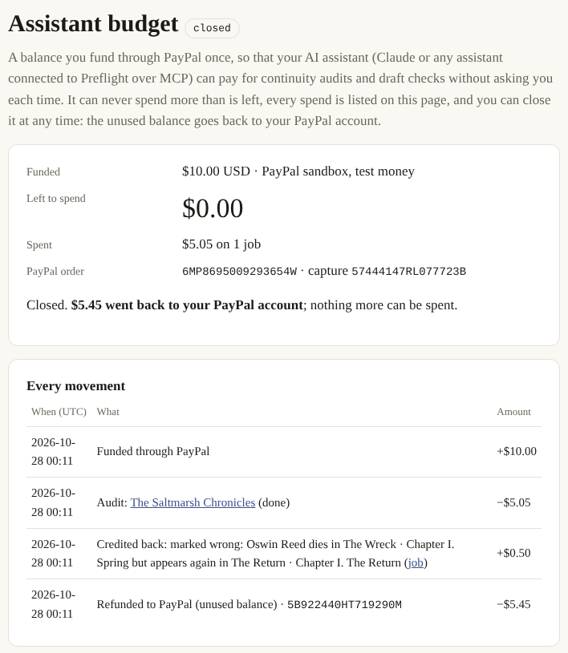

# Preflight in detail: the paid service and its money paths

A series audit has a knowable price before it runs — the token count is known the moment the
files land — which makes it a natural pay-per-job service. `canonkeeper serve` runs it:

```
upload series ──▶ quote ($5 + $4 per 100k tokens, shown with the arithmetic)
      ──▶ PayPal Orders v2 checkout (sandbox) ──▶ capture ──▶ audit runs in the background
      ──▶ report + bible pages, job page shows live progress

writing the next book? ──▶ upload the draft on the finished audit's page
      ──▶ quote ($2 + $4 per 100k draft tokens) ──▶ same checkout
      ──▶ only the places the draft disagrees with the published books
```

```bash
canonkeeper serve                      # no keys: demo mode (rule-based answers, simulated PayPal)
GEMINI_API_KEY=… canonkeeper serve     # real audits on the Gemini free tier, PayPal still simulated
PAYPAL_CLIENT_ID=… PAYPAL_CLIENT_SECRET=… canonkeeper serve   # real PayPal sandbox (or put them in .env)
canonkeeper doctor --paypal            # proves the credentials: OAuth + a sandbox order, never captured
canonkeeper doctor --round-trip        # sandbox: $1 order you approve as the buyer → capture → verify → refund
```

`render.yaml` deploys the same service as a free Render web service (set the three keys in the
dashboard, or none for demo mode); `--public-url` is what PayPal sends the buyer back to. The
free plan sleeps after ~15 idle minutes and its disk does not survive a restart: while an audit
runs the service pings its own URL so it is not put to sleep mid-job, but download the report
you want to keep. After a deploy, `python scripts/smoke_hosted.py <url> --order` checks the
key, the PayPal mode, the sample, a demo quote and the redirect to PayPal's approval page,
without approving anything or running a model.

**Built to survive the judging period on free tiers.** A free Render instance that sleeps loses its
disk, and a free model tier has a daily request cap. So: `PREFLIGHT_KEEP_AWAKE_UNTIL` (set to the day
after judging in `render.yaml`) keeps the instance awake, which one instance can do all month within
Render's free hours; an order the day's model quota cannot finish is refused *before* a PayPal order
exists ("nothing was charged", with the reset time), on the web page and over MCP; and real Gemini
answers for the demo series ship in the package (`preflight/demo_recording/`, made by
`scripts/record_demo.py`), so a cold instance runs the demo with zero requests, and a keyless local
run answers the demo series with those recorded answers, labelled as such on every page and on the
report, instead of the rule-based stand-in. A test fails if a prompt change makes the recording stale.

**Three ways a payment reaches Preflight, one rule for all of them.** With sandbox or live
credentials the quote page shows PayPal's own JS SDK buttons (PayPal, Venmo and Pay Later where the
buyer is eligible), approved in PayPal's window; the plain redirect to PayPal's page stays beside them
and is what an AI agent's link uses. If the buyer approves and closes the tab, PayPal's webhook
(`/paypal/webhook`: `CHECKOUT.ORDER.APPROVED`, `PAYMENT.CAPTURE.COMPLETED`, each signature verified
with PayPal) or the "check payment" button finishes the job. Every route ends in the same `settle()`,
which asks PayPal for the order and pays the job only on a completed capture of the quoted amount, so
a forged notice could not mark anything paid. The job page carries a receipt: amount, order,
capture, and any refund.

After payment the money path is one function (`preflight/payments.py`): a job is paid only on a
completed capture of the quoted amount, a buyer who approved and closed the tab can press
"check payment", and an audit that fails can be refunded in full through PayPal instead of
retried.

<p align="center">


</p>

**Tested on PayPal's real sandbox, end to end** (Oct 28, 2026): a demo audit paid with PayPal's
card button (order `0VT10566WP533404Y`, capture `93D58029P7835205H`) and a finding marked wrong
($0.50 partial refund `3AA80535F2725261T`), above; and the agent path below: a $10 budget funded
through PayPal, $5.05 spent on an audit by an assistant over MCP, $0.50 credited back by the
guarantee, and the budget closed with the unused $5.45 refunded through PayPal (refund
`5B922440HT719290M`).

<p align="center">

</p>

Nothing is sent to a model until the order is captured. Jobs persist as JSON on disk, run one
at a time (free-tier pacing is per project, so parallelism would only contend), and a failed
job can be retried at no extra cost because every model response is cached. The PayPal client
(`PayPalClient`, about 170 lines) is Orders v2 (OAuth → create with `PAY_NOW` → capture,
idempotent on `PayPal-Request-Id`), Payments v2 refunds, and webhook verification and
registration; `FakePayPal` mirrors the state machine for tests and demos.

**Agentic commerce.** The same service is an MCP server: hosted at `<url>/mcp` (streamable HTTP,
stateless JSON; how to connect is on `/assistant`) and on stdio as `canonkeeper mcp`. Its 19 tools
carry MCP annotations (read-only, cannot be undone, talks to PayPal). Two ways to pay:

- *Per job:* `quote_series` (or `request_upload_link`: the person uploads and sees the price) →
  `order_audit` → the person approves on PayPal → `confirm_payment` → `audit_status` →
  `get_findings`; `check_draft` for each new book.
- *A budget:* `open_budget` (optionally with the person's limit per purchase and end date) → the
  person approves on PayPal → `confirm_budget` → `pay_with_budget` for each audit or draft check,
  never past the balance or the limits → `close_budget` refunds the rest. The person can tighten
  the limits, or stop all spending, on the budget's page; nobody can loosen them.

The assistant never holds the buyer's credentials and cannot approve a payment: the approval link
always goes to the person. Money comes back the same way: `mark_finding_wrong` only returns a
link where the person confirms it on their job page, and the refund moves on their click. `audit_status` hands back a read-only `share_url` for an editor;
the job id itself stays private, because it is the key that marks findings wrong, refunds and
deletes. `python scripts/mcp_flow_demo.py books/*.txt` (with `canonkeeper serve` running) shows
the whole exchange from a client over stdio, including `confirm_payment` refusing to run anything
before the person approves.

Built for the [PayPal AI Hackathon](https://paypalaihackathon.devpost.com/) (submissions due
**Nov 12, 2026**).

## Status, item by item

Working offline pipeline; real-model runs on the Gemini free tier. See
[docs/DEMO_SCRIPT.md](docs/DEMO_SCRIPT.md) for the demo plan and the roadmap below for what lands when.

- [x] corpus loading, chapterizing, provenance offsets
- [x] claim extraction with quote grounding
- [x] bible store, alias resolution, slot index
- [x] candidate heuristics (slot mismatch, dead-speaks, timeline, name drift, origin
      mismatch, household role collision)
- [x] predicate / value normalisation at ingest
- [x] batched adjudicator, series-as-prefix for prompt caching, budgeted context assembly
- [x] audit report + bible viewer (HTML/JSON)
- [x] seeded-defect eval harness
- [x] offline demo with a rule-based provider
- [x] CLI, tests, CI
- [x] chapterizer verified against the real Gutenberg layouts of all six Holmes volumes
- [x] `check` on an unpublished draft, with the deliberate-reveal case in the demo
- [x] Gemini free-tier provider with pacing, backoff, JSON-mode fallback; `doctor` command
- [x] first real run on Sherlock Holmes (Watson's wound found; 2,331 sourced facts)
- [x] second benchmark run with the descriptive sweep: P 0.80 / R 0.40 rescored, artifacts committed
- [x] Preflight: upload → quote → PayPal checkout → capture → audit → report (`canonkeeper serve`)
- [x] PayPal sandbox credentials and Orders v2 create verified (`canonkeeper doctor --paypal`)
- [x] payment hardening: one `settle()` for every way a payment is noticed, capture must be
      COMPLETED for the quoted amount, "check payment" for a closed tab, refunds for failed
      audits (Payments v2), path-safe job ids, no open redirect; tests on Linux and Windows
- [x] capture + refund exercised against the live sandbox: a paid audit, a guarantee refund, and a
      budget funded, spent, credited and closed with the rest refunded (the PayPal ids are in the
      screenshots above)
- [x] full sandbox checkout filmed by `scripts/video/record.py` (PayPal's own guest card form)
- [x] Preflight as an MCP server (`canonkeeper mcp`): an author's assistant quotes, orders,
      hands the person the PayPal approval link, confirms, and reads the findings as data
- [x] MCP flow exercised end to end from a real MCP client (`scripts/mcp_flow_demo.py`)
- [x] customers can delete their files; uploads capped for a public host; `render.yaml`
- [x] the job page's address is the owner's key (mark wrong, refund, delete); a finished report
      is shared through a separate read-only link (`/r/<id>`) that never contains it
- [x] local-model mode run against Ollama (`qwen3:4b`, CPU) — see *Local mode, measured*
- [ ] demo video
